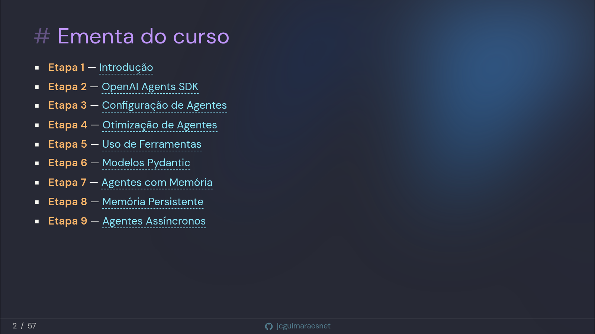

<div align="center">

# 🤖 Curso: Desenvolvimento de Agentes Inteligentes 

Material para o curso em formato de slides online.

<br/>

[](https://jcguimaraesnet.github.io/course-intelligent-agents/ai-agents/)
[](https://jcguimaraesnet.github.io/course-intelligent-agents/n8n/)
[](https://jcguimaraesnet.github.io/course-intelligent-agents/block-project/)
<br/><br/>
[](https://sli.dev)
[](https://www.python.org)
[](https://github.com/jcguimaraesnet)

</div>

<br/>

## 📚 Ementa do curso

<div align="center">
  
</div>

<br/>

## 🖥️ Rodando os decks no VS Code

Antes de tudo, instale as dependências na raiz do repositório:

```bash
pnpm install   # ou: npm install
```

Depois, abra a pasta do repositório no VS Code e instale a extensão
[Slidev](https://marketplace.visualstudio.com/items?itemName=antfu.slidev), que o próprio
VS Code sugere ao abrir a pasta.

O repositório tem mais de um deck na raiz (`slides-*.md`). 

| # | Comando | Quando usar |
|---|---------|-------------|
| 1 | `Slidev: Choose active slides entry` | escolhe o deck ativo |
| 2 | `Slidev: Configure preview port` | define a porta **desse** deck |
| 3 | `Slidev: Start slidev dev server` | sobe o servidor do deck ativo |

Portas em uso neste repo:

| Deck | Porta |
|------|-------|
| `slides-ai-agents.md` | 3030 |
| `slides-n8n.md` | 3131 |
| `slides-block-project.md` | 3232 |


---

<div align="center">

### ⭐ Gostou do conteúdo?

Deixe uma **star** no repositório! <br/>
É o que me incentiva a manter o material atualizado e a publicar as próximas etapas.

[](https://github.com/jcguimaraesnet/course-intelligent-agents)

</div>
