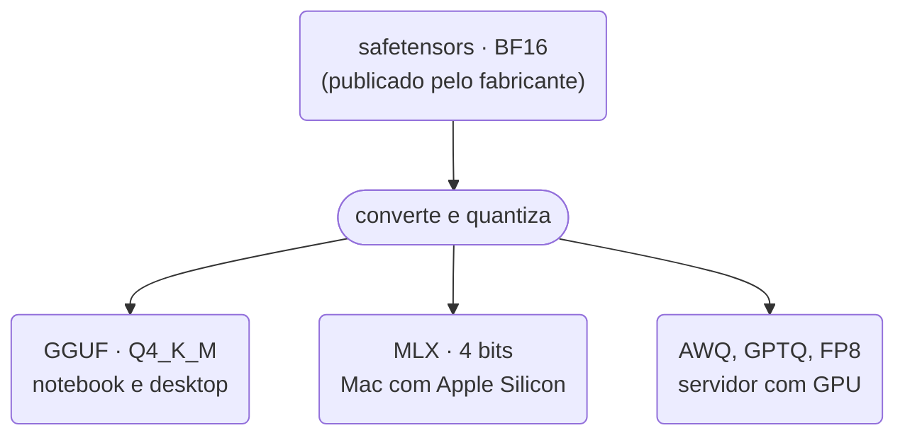

## Etapa 13 - Tema Relacionado
<br/>

### **Modelos Abertos e Locais**

---
layout: two-cols-header
layoutClass: gap-8
class: flex items-center justify-center
sourceLabel: Open Source Initiative (OSI)
source: https://opensource.org/ai/open-source-ai-definition
---

# Modelos abertos e locais

#### **Aberto diz o que você pode baixar; local diz onde ele roda**

<div class="h-2" />

::left::

<div class="text-17px w-full self-start [&_ul]:my-0 [&_li]:mb-4">

- **Pesos abertos** (*open weights*): o arquivo com os parâmetros treinados pode ser baixado
- Dados e código de treino quase nunca vêm junto, por isso não é *open source* para a OSI
- Todo modelo local é aberto, mas **nem todo aberto** cabe na sua máquina

</div>

::right::

<div class="w-full self-start">

<div class="text-15px [&_table]:w-full [&_td]:py-2 [&_th]:py-2">

| **Modelo** | **Pesos abertos?** | **Roda no notebook?** |
| --- | --- | --- |
| Claude, GPT, Gemini | ❌ | ❌ |
| Kimi K3 (2,8 tri parâmetros) | ✅ | ❌ |
| Gemma 4 E4B | ✅ | ✅ |

</div>

</div>

<!--
## a OSI publicou a Open Source AI Definition 1.0 em 2024: exige informação sobre os dados de treino

## olhar a licença: Apache 2.0 e MIT são livres; Llama e Qwen Max têm licença própria com restrições
-->

---
layout: two-cols-header
layoutClass: gap-8
class: flex items-center justify-center
---

# Quando usar modelo local

#### **Você ganha controle e paga com qualidade e manutenção**

<div class="h-2" />

::left::

<div class="text-17px w-full self-start [&_ul]:my-0 [&_li]:mb-4">

- **Privacidade:** o dado sensível não sai da sua máquina
- **Custo previsível:** sem cobrança por token em tarefa repetitiva
- **Independência:** funciona offline e o modelo não muda sem você saber
- **O preço:** qualidade abaixo dos modelos de ponta e hardware por sua conta

</div>

::right::

<div class="w-full self-start">

<div class="text-15px [&_table]:w-full [&_td]:py-2 [&_th]:py-2">

| ✅ **Vale a pena** | ❌ **Não vale** |
| --- | --- |
| Dados de saúde ou jurídicos | Raciocínio longo e complexo |
| Classificar e rotear mensagens | Poucas chamadas por mês |
| Alto volume de tarefas simples | Contexto grande sem GPU |
| Ambiente sem internet | Precisa do melhor modelo |

</div>

</div>

<!--
## a pergunta prática: o dado pode sair da empresa? se não pode, a conversa acaba aqui

## no projeto de bloco: o roteador (etapa 11) é bom candidato a SLM local; a resposta final, nem tanto
-->

---
layout: two-cols-header
layoutClass: gap-8
class: flex items-center justify-center
---

# Quem publica modelos abertos

#### **Os modelos abertos mais conhecidos são chineses e americanos**

<div class="h-2" />

::left::

<div class="text-17px w-full self-start [&_ul]:my-0 [&_li]:mb-4">

- **China:** Alibaba (Qwen), DeepSeek, Z.ai (GLM), Moonshot (Kimi), Xiaomi (MiMo)
- **EUA:** Google (Gemma), Meta (Llama), OpenAI (gpt-oss), NVIDIA (Nemotron), Microsoft (Phi)
- **Europa:** Mistral, da França

</div>

::right::

<div class="grid grid-cols-3 gap-x-4 gap-y-3 w-full self-start text-center text-13px">
  <div><div class="h-14 rounded-xl bg-white/90 flex items-center justify-center"><div class="i-logos-qwen-icon text-4xl" /></div>Qwen</div>
  <div><div class="h-14 rounded-xl bg-white/90 flex items-center justify-center"><div class="i-logos-deepseek-icon text-4xl" /></div>DeepSeek</div>
  <div><div class="h-14 rounded-xl bg-white/90 flex items-center justify-center"><div class="i-logos-google-icon text-4xl" /></div>Gemma</div>
  <div><div class="h-14 rounded-xl bg-white/90 flex items-center justify-center"><div class="i-logos-meta-icon text-4xl" /></div>Llama</div>
  <div><div class="h-14 rounded-xl bg-white/90 flex items-center justify-center"><div class="i-logos-openai-icon text-4xl" /></div>gpt-oss</div>
  <div><div class="h-14 rounded-xl bg-white/90 flex items-center justify-center"><div class="i-logos-mistral-ai-icon text-4xl" /></div>Mistral</div>
  <div><div class="h-14 rounded-xl bg-white/90 flex items-center justify-center"><div class="i-logos-nvidia text-base" /></div>Nemotron</div>
  <div><div class="h-14 rounded-xl bg-white/90 flex items-center justify-center"><div class="i-logos-microsoft-icon text-4xl" /></div>Phi</div>
  <div><div class="h-14 rounded-xl bg-white/90 flex items-center justify-center"><div class="i-logos-ibm text-2xl" /></div>Granite</div>
</div>

<!--
## GLM, Kimi e MiMo não têm logo no pacote de ícones, mas estão no topo do ranking

## a Meta hoje publica também a linha Muse, além do Llama
-->

---
layout: two-cols-header
layoutClass: gap-8
class: flex items-center justify-center
sourceLabel: NVIDIA Research
source: https://arxiv.org/abs/2506.02153
---

# SLM e LLM

#### **A definição de um SLM pode variar entre autores em relação aos parâmetros (qtde)**

<div class="h-2" />

::left::

<div class="text-17px w-full self-start [&_ul]:my-0 [&_li]:mb-4">

- **SLM** (*Small Language Model*) roda num dispositivo comum e responde rápido para um usuário
- O índice da **Artificial Analysis** considera *Tiny* até 4 bi e *Small* de 4 a 40 bi
- A tese da NVIDIA: a maioria das chamadas de um agente **não precisa** de um LLM

</div>

::right::

<div class="w-full self-start">

<div class="text-15px [&_table]:w-full [&_td]:py-2 [&_th]:py-2">

| | **SLM** | **LLM** |
| --- | --- | --- |
| Parâmetros | até ~10 bi | acima de 10 bi |
| Onde roda | notebook, celular | cluster de GPUs |
| Bom para | tarefa específica | raciocínio amplo |
| Exemplos | Gemma 4 E4B, Qwen3.5 4B | Kimi K3, DeepSeek V4.1 |

</div>

</div>

<!--
## o artigo define SLM pelo uso (cabe e é rápido), não por um número fixo de parâmetros

## exemplo de divisão: SLM para rotear e chamar tools; LLM só para a parte difícil
-->

---
layout: two-cols-header
layoutClass: gap-8
class: flex items-center justify-center
sourceLabel: Hugging Face
source: https://huggingface.co/docs/hub/gguf
---

# O que é um modelo quantizado

#### **Menos bits por peso: o modelo encolhe e perde um pouco de precisão**

<div class="h-2" />

::left::

<div class="text-17px w-full self-start [&_ul]:my-0 [&_li]:mb-4">

- Cada peso é um número que, no treino, ocupa **16 bits**
- **Quantizar** é guardar esse número com menos bits: 8, 4, até 2
- É como um JPEG: o arquivo fica bem menor e a diferença quase não aparece

</div>

::right::

<div class="w-full self-start flex flex-col gap-5 text-14px">
  <div>
    <div class="flex justify-between mb-1"><b>16 bits</b><span>65.536 valores possíveis</span></div>
    <div class="flex gap-1"><div v-for="i in 16" :key="i" class="w-5 h-7 rounded-sm bg-gray-400" /></div>
  </div>
  <div>
    <div class="flex justify-between mb-1"><b>8 bits</b><span>256 valores possíveis</span></div>
    <div class="flex gap-1"><div v-for="i in 8" :key="i" class="w-5 h-7 rounded-sm bg-purple-400" /></div>
  </div>
  <div>
    <div class="flex justify-between mb-1"><b>4 bits</b><span>16 valores possíveis</span></div>
    <div class="flex gap-1"><div v-for="i in 4" :key="i" class="w-5 h-7 rounded-sm bg-purple-400" /></div>
  </div>
  <div>
    <div class="flex justify-between mb-1"><b>2 bits</b><span>4 valores possíveis</span></div>
    <div class="flex gap-1"><div v-for="i in 2" :key="i" class="w-5 h-7 rounded-sm bg-purple-400" /></div>
  </div>
  <div class="text-12px opacity-60">Cada quadrado é 1 bit de um único peso do modelo.</div>
</div>

<!--
## GGUF é o formato do llama.cpp e do Ollama; MLX é do Mac; AWQ, GPTQ e FP8 aparecem no vLLM

## o "K_M" é uma mistura: camadas mais sensíveis ficam com mais bits — por isso ~4,9 e não 4
-->

---

# O que se perde ao quantizar

#### **Pergunta ao modelo: qual é a capital do Brasil e quando foi inaugurada?**

<br/>

<div class="[&_table]:w-full text-13px leading-tight [&_td]:py-2 [&_th]:py-3">

| Bits | Tons por pixel | A foto | Resposta do modelo |
| --- | --- | --- | --- |
| **16** | ~65 mil | Original | "Brasília, inaugurada em 1960." |
| **8** | 256 | O olho não percebe diferença | "Brasília, inaugurada em 1960." |
| **4** | 16 | Reconhece a pessoa, mas somem detalhes finos | Quase sempre certa; às vezes erra o ano: "1956" |
| **2** | 4 | Vê que é uma pessoa, mas não quem | "A capital do Brasil é o Rio de Janeiro…" |

</div>

<div class="h-4" />

<Transform :scale="0.8" origin="left bottom">

> [!NOTE]
> Um peso é como um pixel: sozinho não guarda nenhuma palavra. O conhecimento está no conjunto, e o que é raro (datas, números, nomes) some primeiro.

</Transform>

<!--
## exemplo ilustrativo, não é um teste medido: serve para dar a intuição do efeito

## 1956 é o ano em que JK assumiu e a construção começou; o Rio foi capital até 1960 — erros "vizinhos" do certo
-->

---
layout: two-cols-header
layoutClass: gap-8
class: flex items-center justify-center
sourceLabel: Hugging Face
source: https://huggingface.co/docs/hub/gguf
---

# Formatos de arquivo de modelos

#### **O mesmo modelo é publicado em formatos diferentes, um para cada tipo de máquina**

<div class="h-2" />

::left::

<div class="text-17px w-full self-start [&_ul]:my-0 [&_li]:mb-4">

- **safetensors:** o original do fabricante, em 16 bits; exige GPU com muita memória
- **GGUF:** pesos quantizados num só arquivo; roda em notebook e desktop, com ou sem GPU
- **MLX:** versão otimizada para Macs com Apple Silicon
- **AWQ, GPTQ, FP8:** o mesmo safetensors, só que quantizado; para servidores com GPU

</div>

::right::

<Transform :scale="1.1" origin="top">



</Transform>

<!--
## o GGUF leva junto o tokenizer e o template do chat: por isso o Ollama roda com um arquivo só

## safetensors substituiu o .bin do PyTorch, que podia executar código ao ser carregado
-->

---
layout: two-cols-header
layoutClass: gap-8
class: flex items-center justify-center
sourceLabel: Hugging Face
source: https://huggingface.co/Qwen/Qwen3-8B
---

# Quanto o arquivo encolhe

#### **O mesmo Qwen3 8B em cada formato: de 16,4 GB para menos de 5 GB**

<div class="h-2" />

::left::

<div class="text-17px w-full self-start [&_ul]:my-0 [&_li]:mb-4">

- Mesmo modelo, mesmos **8,2 bi** de parâmetros, em formatos diferentes
- Em 4 bits, o arquivo fica com **cerca de um terço** do original
- Na prática: sai de uma GPU de **24 GB** e cabe numa de **8 GB**

</div>

::right::

<div class="w-full self-start flex flex-col gap-3 text-14px">
  <div>
    <div class="flex justify-between mb-1"><span><b>safetensors</b> · BF16</span><span>16,4 GB</span></div>
    <div class="h-5 rounded bg-white/10"><div class="h-full rounded bg-gray-400" style="width: 100%" /></div>
  </div>
  <div>
    <div class="flex justify-between mb-1"><span><b>FP8</b> · 8 bits</span><span>9,4 GB · 58%</span></div>
    <div class="h-5 rounded bg-white/10"><div class="h-full rounded bg-purple-400" style="width: 58%" /></div>
  </div>
  <div>
    <div class="flex justify-between mb-1"><span><b>AWQ</b> · 4 bits</span><span>6,1 GB · 37%</span></div>
    <div class="h-5 rounded bg-white/10"><div class="h-full rounded bg-purple-400" style="width: 37%" /></div>
  </div>
  <div>
    <div class="flex justify-between mb-1"><span><b>GGUF</b> · Q4_K_M</span><span>5,0 GB · 31%</span></div>
    <div class="h-5 rounded bg-white/10"><div class="h-full rounded bg-purple-400" style="width: 31%" /></div>
  </div>
  <div>
    <div class="flex justify-between mb-1"><span><b>MLX</b> · 4 bits</span><span>4,4 GB · 27%</span></div>
    <div class="h-5 rounded bg-white/10"><div class="h-full rounded bg-purple-400" style="width: 27%" /></div>
  </div>
</div>

<!--
## tamanhos somados dos arquivos nos repositórios oficiais da Qwen no Hugging Face (BF16, FP8, AWQ, GGUF e MLX-4bit)

## o AWQ fica maior que o GGUF porque mantém as camadas de entrada e saída em 16 bits
-->

---
layout: two-cols-header
layoutClass: gap-8
class: flex items-center justify-center
---

# O que é o KV cache

#### **Um cache da conversa em andamento, para aumentar a velocidade de resposta**

<div class="h-2" />

::left::

<div class="text-17px w-full self-start [&_ul]:my-0 [&_li]:mb-4">

- O modelo escreve **uma palavra por vez** e, para cada uma, precisa olhar **todo o texto anterior**
- O **KV cache** guarda o que ele já leu, para não reler tudo a cada palavra
- O KV cache é usado **somente na requisição em execução** (não confundir com *prompt caching*, usado entre requisições)
- O ganho é velocidade; o preço é **memória**

</div>

::right::

<div class="w-full self-start flex flex-col gap-5 text-13px">
  <div>
    <div class="mb-2"><b>Sem KV cache:</b> relê tudo a cada palavra</div>
    <div v-for="n in [5, 6, 7]" :key="n" class="flex gap-1 mb-1">
      <span v-for="(t, i) in ['A', 'capital', 'do', 'Brasil', 'é', 'Brasília', ','].slice(0, n)" :key="i" class="px-1.5 py-0.5 rounded bg-purple-400 text-black">{{ t }}</span>
    </div>
  </div>
  <div>
    <div class="mb-2"><b>Com KV cache:</b> lê só a palavra nova</div>
    <div v-for="n in [5, 6, 7]" :key="n" class="flex gap-1 mb-1">
      <span v-for="(t, i) in ['A', 'capital', 'do', 'Brasil', 'é', 'Brasília', ','].slice(0, n)" :key="i" class="px-1.5 py-0.5 rounded" :class="n > 5 && i < n - 1 ? 'bg-white/15' : 'bg-purple-400 text-black'">{{ t }}</span>
    </div>
  </div>
  <div class="flex gap-4 text-12px opacity-70">
    <span><span class="inline-block w-3 h-3 rounded-sm bg-purple-400 mr-1" />processado agora</span>
    <span><span class="inline-block w-3 h-3 rounded-sm bg-white/15 mr-1" />consultado no cache</span>
  </div>
</div>

<!--
## K e V vêm de Key e Value: os dois vetores que a atenção calcula para cada token

## simplificação: no diagrama cada palavra é um token; na prática, um token é um pedaço de palavra
-->

---
layout: two-cols-header
layoutClass: gap-8
class: flex items-center justify-center
sourceLabel: Ollama
source: https://docs.ollama.com/context-length
---

# Janela de contexto custa memória

#### **Cada token da conversa ocupa espaço na GPU, no KV cache**

<div class="h-2" />

::left::

<div class="text-17px w-full self-start [&_ul]:my-0 [&_li]:mb-4">

- A **janela de contexto** é o máximo de tokens por requisição e define o tamanho do **KV cache**
- A janela de contexto deve ser **configurada para cada cenário** de negócio agêntico
- Cenários agênticos que impactam a janela: vida útil da memória, tamanho dos prompts, nível de raciocínio, tamanho das saídas e **resultados de tools e RAG**

</div>

::right::

<div class="w-full self-start">

<div class="text-15px [&_table]:w-full [&_td]:py-2 [&_th]:py-2">

| **Modelo** | **Pesos (4 bits)** | **Janela** | **KV cache** |
| --- | --- | --- | --- |
| Qwen3 8B | 5,0 GB | 4K tokens | 0,6 GB |
| Qwen3 8B | 5,0 GB | 16K tokens | 2,4 GB |
| Qwen3 8B | 5,0 GB | 32K tokens | 4,8 GB |

</div>

</div>

<!--
## em 32K o contexto já pesa quase o mesmo que o modelo inteiro

## a documentação do Ollama recomenda pelo menos 64K para agentes e ferramentas de código
-->

---
sourceLabel: Qwen3-8B
source: https://huggingface.co/Qwen/Qwen3-8B/blob/main/config.json
---

# O modelo cabe na minha GPU?

#### **Memória ≈ pesos + KV cache + engine runtime**

<br/>

<div class="[&_table]:w-full text-13px leading-tight [&_td]:py-2 [&_th]:py-3">

| Modelo | Quantização | Pesos | Janela | KV cache | Engine runtime | Total |
| --- | --- | --- | --- | --- | --- | --- |
| Qwen3 8B | BF16 | 16,4 GB | <span class="text-yellow-300 italic">32K</span> | 4,8 GB | 1,0 GB | **22,2 GB** |
| Qwen3 8B | Q8_0 | 8,7 GB | <span class="text-yellow-300 italic">32K</span> | 4,8 GB | 1,0 GB | **14,5 GB** |
| Qwen3 8B | Q4_K_M | 5,0 GB | <span class="text-yellow-300 italic">32K</span> | 4,8 GB | 1,0 GB | **10,8 GB** |
| Qwen3 8B | BF16 | 16,4 GB | <span class="text-orange-400 font-bold">16K</span> | 2,4 GB | 1,0 GB | **19,8 GB** |
| Qwen3 8B | Q8_0 | 8,7 GB | <span class="text-orange-400 font-bold">16K</span> | 2,4 GB | 1,0 GB | **12,1 GB** |
| Qwen3 8B | Q4_K_M | 5,0 GB | <span class="text-orange-400 font-bold">16K</span> | 2,4 GB | 1,0 GB | **8,4 GB** |

</div>

<div class="absolute bottom-12 left-14 right-14 grid grid-cols-[1fr_auto_1fr_auto_1fr] items-center gap-3 text-14px text-center">
  <div class="rounded-lg border border-purple-400/40 bg-purple-400/10 p-3">
    <div class="i-ri-file-3-line text-2xl text-purple-300 mx-auto mb-1" />
    <b>Pesos</b>
  </div>
  <div class="i-ri-add-line text-2xl opacity-60" />
  <div class="rounded-lg border border-purple-400/40 bg-purple-400/10 p-3">
    <div class="i-ri-database-2-line text-2xl text-purple-300 mx-auto mb-1" />
    <b>KV cache</b>
  </div>
  <div class="i-ri-add-line text-2xl opacity-60" />
  <div class="rounded-lg border border-purple-400/40 bg-purple-400/10 p-3">
    <div class="i-ri-settings-3-line text-2xl text-purple-300 mx-auto mb-1" />
    <b>Engine runtime</b>
  </div>
</div>

<!--
## mesma janela nos três: só a quantização muda — 22,2 GB pede GPU de 24 GB; 10,8 GB cabe numa de 12 GB

## KV cache = 2 × 36 camadas × 8 cabeças KV × 128 × 32.768 tokens × 2 bytes ≈ 4,8 GB (valores do config.json)

## dá para cortar o KV cache pela metade com OLLAMA_KV_CACHE_TYPE=q8_0 (exige flash attention)
-->

---
layout: two-cols-header
layoutClass: gap-8
class: flex items-center justify-center
---

# Rodando sem GPU

#### **Sem GPU, quem manda é a RAM e a velocidade da memória**

<div class="h-2" />

::left::

<div class="text-17px w-full self-start [&_ul]:my-0 [&_li]:mb-4">

- O modelo inteiro precisa caber na **RAM**, com folga para o sistema
- A velocidade vem da **banda de memória**: cada token lê os pesos de novo
- Modelos **MoE** ajudam: muitos parâmetros no disco, poucos **ativos** por token

</div>

::right::

<div class="w-full self-start">

<div class="text-15px [&_table]:w-full [&_td]:py-2 [&_th]:py-2">

| **RAM livre** | **Modelos que cabem (4 bits)** |
| --- | --- |
| 8 GB | Llama 3.2 3B, Qwen3.5 4B, Gemma 4 E2B |
| 16 GB | Qwen3 8B, Gemma 4 E4B, gpt-oss 20B |
| 32 GB | Gemma 4 26B A4B, Qwen3.6 35B A3B |

</div>

</div>

<!--
## regra prática: tokens por segundo ≈ banda da memória ÷ tamanho dos pesos ativos

## MoE = Mixture of Experts: o modelo escolhe poucos "especialistas" por token
-->

---
layout: two-cols-header
layoutClass: gap-8
class: flex items-center justify-center
sourceLabel: Artificial Analysis
source: https://artificialanalysis.ai/models/open-source
---

# Ranking de modelos abertos

#### **Artificial Analysis: uma nota única a partir de vários testes independentes**

<div class="h-2" />

::left::

<div class="text-17px w-full self-start [&_ul]:my-0 [&_li]:mb-4">

- Roda os **mesmos testes** em todos os modelos e publica uma nota única
- Dá para filtrar **só os abertos** e separar por tamanho
- O melhor aberto (**46**) ainda fica atrás do melhor fechado (**58**)

</div>

::right::

<div class="w-full self-start">

<div class="text-15px [&_table]:w-full [&_td]:py-2 [&_th]:py-2">

| **Modelo aberto** | **Parâmetros** | **Nota** |
| --- | --- | --- |
| MiMo-V2.6-Pro | 1 tri | 46 |
| DeepSeek V4.1 Flash | 552 bi | 45 |
| GLM-5.3 | 753 bi | 45 |
| Qwen3.8 27B | 27 bi | 34 |
| Gemma 4 26B A4B | 25 bi | 17 |

</div>

<div class="h-4" />

<Transform :scale="0.8" origin="left top">

> [!CAUTION]
> Os líderes têm **centenas de bilhões** de parâmetros: são abertos, mas não rodam no seu notebook.

</Transform>

</div>

<!--
## números do Intelligence Index v4.3.2, outubro de 2026: reconferir no site antes da aula

## mostrar ao vivo o filtro por tamanho: Tiny (até 4B), Small (até 40B), Medium e Large
-->

---
sourceLabel: Bizon Tech
source: https://bizon-tech.com/blog/best-llm-inference-engines
---

# Engines para rodar modelos locais

#### **Cada uma resolve um problema: conveniência, desempenho ou escala**

<br/>

<div class="[&_table]:w-full text-13px leading-tight [&_td]:py-2 [&_th]:py-3">

| Engine | Como você usa | Melhor para |
| --- | --- | --- |
| **Ollama** | Terminal e app | Começar rápido, um usuário |
| **LM Studio** | App desktop (GUI) | Explorar modelos sem terminal |
| **llama.cpp** | Biblioteca C/C++ e `llama-server` | A base de quase todas; roda até em CPU |
| **vLLM** | Servidor | Vários usuários ao mesmo tempo, em GPU |
| **SGLang** | Servidor | Alta concorrência e saída estruturada |
| **MLX** | Framework da Apple | Macs com Apple Silicon |

</div>

<div class="h-4" />

<Transform :scale="0.8" origin="left bottom">

> [!TIP]
> Todas expõem uma API **compatível com a da OpenAI**: trocar de engine não muda o código do agente.

</Transform>

<!--
## Ollama, LM Studio e Jan são camadas de conveniência; por baixo, quase sempre está o llama.cpp

## o TGI do Hugging Face entrou em modo de manutenção e recomenda vLLM, SGLang, llama.cpp e MLX
-->

---
layout: two-cols-header
layoutClass: gap-8
class: flex items-center justify-center
sourceLabel: Ollama
source: https://docs.ollama.com/api/openai-compatibility
---

# Rodando modelos com o Ollama

#### **Um comando para baixar, um para conversar e uma API para programar**

<div class="h-2" />

::left::

<div class="text-17px w-full self-start [&_ul]:my-0 [&_li]:mb-4">

- `ollama run` baixa o modelo na primeira vez e abre o chat no terminal
- Sobe uma API em `localhost:11434`, **compatível com a da OpenAI**
- **Q4_K_M** é a versão padrão da maioria dos modelos no Ollama e o melhor ponto de partida
- **4K de contexto** é o padrão do Ollama em GPU com pouca memória; se a janela estourar, o excesso é descartado sem erro

</div>

::right::

<div class="w-full self-start">

::code-group

```bash [terminal]{maxHeight:'260px'}
# Linux / WSL (Windows e macOS: baixe o app)
curl -fsSL https://ollama.com/install.sh | sh

# baixa e abre o chat
ollama run hf.co/Qwen/Qwen3-0.6B-GGUF:Q8_0

ollama list   # modelos baixados
ollama ps     # memória, GPU/CPU e contexto

# contexto maior que o padrão
OLLAMA_CONTEXT_LENGTH=32768 ollama serve
```

```bash [testar a API]{maxHeight:'260px'}
curl http://localhost:11434/v1/chat/completions \
  -H "Content-Type: application/json" \
  -d '{
    "model": "hf.co/Qwen/Qwen3-0.6B-GGUF:Q8_0",
    "messages": [
      {"role": "user", "content": "Olá!"}
    ]
  }'
```

::

</div>

<!--
## mostrar o ollama ps ao vivo: coluna PROCESSOR (GPU/CPU) e coluna CONTEXT

## o Qwen3 "pensa" antes de responder: /no_think no fim da pergunta deixa mais rápido na CPU
-->

---
layout: two-cols-header
layoutClass: gap-8
class: flex items-center justify-center
sourceLabel: Hugging Face
source: https://huggingface.co/docs/hub/local-apps
---

# Buscando modelos no Hugging Face

#### **O "GitHub dos modelos": onde quase todo modelo aberto é publicado**

<div class="h-2" />

::left::

<div class="text-17px w-full self-start [&_ul]:my-0 [&_li]:mb-4">

- **Entre** na busca de modelos: [huggingface.co/models](https://huggingface.co/models)
- **Filtre** a busca: *Text Generation*, formato **GGUF** e o app <span class="text-orange-400">Ollama</span>
- **Cadastre seu hardware**: a página mostra qual versão cabe na sua máquina
- Clique em **Use this model** e copie o comando pronto

</div>

::right::

<div class="w-full self-start">

<div class="flex justify-center mb-4">
  <div class="i-logos-hugging-face-icon text-6xl" />
</div>

```text [filtro na busca de modelos]{maxHeight:'130px'}
huggingface.co/models
  ?pipeline_tag=text-generation
  &library=gguf
  &apps=ollama
  &sort=downloads
```

```bash [Use this model → Ollama]{maxHeight:'80px'}
ollama run hf.co/Qwen/Qwen3-0.6B-GGUF:Q8_0
```

</div>

<!--
## repositórios da unsloth, bartowski e ggml-org publicam as versões GGUF dos modelos populares

## o filtro por hardware compara o tamanho do arquivo com a sua memória: é estimativa, não garantia
-->

---
layout: two-cols-header
layoutClass: gap-8
sourceLabel: OpenAI Agents SDK
source: https://openai.github.io/openai-agents-python/models/
---

# Agente com modelo local

#### **O mesmo Agents SDK: só o modelo muda de endereço**

<div class="h-2" />

::left::

```python [main.py]{8-17|19-23|25-32|all}{maxHeight:'320px',at:+1}
# uv add openai-agents
import asyncio
from openai import AsyncOpenAI
from agents import (
    Agent, OpenAIChatCompletionsModel, Runner, set_tracing_disabled,
)

set_tracing_disabled(disabled=True)  # sem chave OpenAI, sem tracing

cliente = AsyncOpenAI(
    base_url="http://localhost:11434/v1",
    api_key="ollama",                 # obrigatória, mas ignorada
)
modelo = OpenAIChatCompletionsModel(
    model="hf.co/Qwen/Qwen3-0.6B-GGUF:Q8_0",
    openai_client=cliente,
)

assistente = Agent(
    name="Assistente Local",
    instructions="Responda em português, em até 3 frases.",
    model=modelo,
)

async def main():
    resultado = await Runner.run(
        starting_agent=assistente,
        input="O que é um modelo quantizado?",
    )
    print(resultado.final_output)

asyncio.run(main())
```

::right::

<div class="w-full self-start text-15px">

<div class="h-2" />

> [!IMPORTANT]
> O Ollama local **não tem chave**, mas o cliente da OpenAI usado pelo Agents SDK exige uma. Por isso o `api_key` leva qualquer texto, e o Ollama **ignora**.

</div>

<!--
## Chat Completions, e não Responses: é a API que quase todo provedor local implementa

## o tracing envia para a OpenAI; sem chave, dá erro 401 — por isso desligamos
-->

---
layout: default
---

# Hands-on

<br/>

🛠️ &nbsp;**Exercício \#1:** Instale o Ollama e converse com um modelo pequeno, como o Qwen3 0.6B.

🛠️ &nbsp;**Exercício \#2:** Calcule se o modelo cabe na sua máquina e confira com `ollama ps`.

🛠️ &nbsp;**Exercício \#3:** Aumente o contexto para 32K e observe a memória subir.

🛠️ &nbsp;**Exercício \#4:** Troque o modelo de um agente do seu TP pelo modelo local.

🛠️ &nbsp;**Exercício \#5:** Compare qualidade e tempo de resposta entre o modelo local e o da API.

<br/>

- [ ] registre RAM/VRAM, modelo, quantização e contexto usados
- [ ] anote os tokens por segundo (`ollama run --verbose`)
- [ ] conclua: o modelo local atende ao seu projeto? justifique

<!--
# Exercício #1 — Instalar
O Qwen3 0.6B roda até sem GPU; com mais memória, testar qwen3:4b ou gemma4:e4b.

# Exercício #2 — A conta
Pesos + KV cache + engine runtime; a coluna PROCESSOR do ollama ps mostra se vazou para a CPU.

# Exercício #3 — Contexto
OLLAMA_CONTEXT_LENGTH=32768 ollama serve; comparar a memória antes e depois.

# Exercício #4 — Trocar o modelo
Só o model do Agent muda: AsyncOpenAI + OpenAIChatCompletionsModel.

# Exercício #5 — A comparação
Não existe resposta certa: o objetivo é formar opinião com dado próprio.
-->
