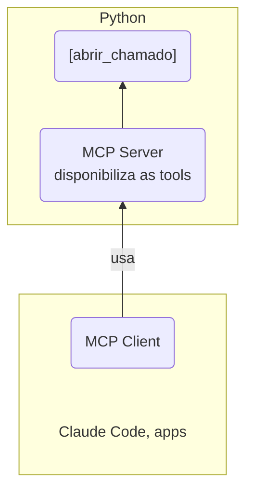
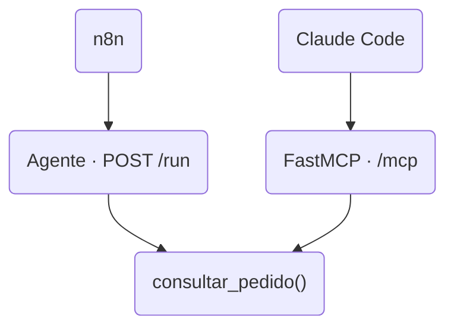

## Etapa 14 - Tema Relacionado
<br/>

### **MCP Server**

---
layout: two-cols-header
layoutClass: gap-8
class: flex items-center justify-center
sourceLabel: Model Context Protocol
source: https://modelcontextprotocol.io/docs/learn/architecture
---

# O que é um MCP Server

#### **O lado do protocolo que oferece ferramentas para a IA**

<div class="h-2" />

::left::

<div class="text-17px w-full self-start [&_ul]:my-0 [&_li]:mb-4">

- **MCP** (*Model Context Protocol*) é um protocolo aberto para ligar aplicações de IA a ferramentas e dados
- O **MCP Server** é o programa que oferece **ferramentas** (*tools*)
- Quem consome é o **host** (Claude Code, Claude Desktop, n8n), com um **MCP client** por servidor
- Roda **local** (stdio) ou **remoto** (HTTP)

</div>

::right::

<Transform :scale="0.65" origin="top">



</Transform>

<!--
## uma tool é uma função que o modelo decide chamar: consultar, criar, enviar

## a mensagem trafega em JSON-RPC: tools/list descobre as tools, tools/call executa uma delas
-->

---
layout: two-cols-header
layoutClass: gap-8
class: flex items-center justify-center
sourceLabel: FastMCP
source: https://gofastmcp.com
---

# O que é o FastMCP

#### **O jeito mais curto de transformar uma função Python num MCP Server**

<div class="h-2" />

::left::

<div class="text-17px w-full self-start [&_ul]:my-0 [&_li]:mb-4">

- **FastMCP** é um framework Python para criar MCP Servers com poucas linhas
- Basta um decorator: nome, descrição e parâmetros da **tool** saem da **assinatura** e da **docstring**
- Cuida do protocolo, da validação e do transporte (stdio ou HTTP)
- A API dele inspirou a do **SDK oficial** de MCP para Python

</div>

::right::

<div class="flex items-center justify-center h-full">
  <AssetImg src="fastmcp-logo.png" class="rounded-lg w-[300px]" />
</div>

<!--
## o FastMCP criou a API de alto nível que entrou no SDK oficial em 2024; hoje segue como projeto próprio, na versão 4

## a docstring vira a descrição que o modelo lê para decidir quando chamar a tool: escreva para o modelo
-->

---
layout: two-cols-header
layoutClass: gap-8
sourceLabel: FastMCP
source: https://gofastmcp.com/deployment/running-server
---

# Primeiro MCP Server com FastMCP

#### **Uma tool, um comando para registrar e um prompt para usar**

<div class="h-2" />

::left::

```python [server.py]{5|7-11|13-14|all}{maxHeight:'320px',at:+1}
# uv init --name loja
# uv add fastmcp
from fastmcp import FastMCP

mcp = FastMCP(name="Loja")

@mcp.tool
def consultar_pedido(codigo: str) -> str:
    """Consulta o status de entrega de um pedido."""
    pedidos = {"A-104": "em trânsito", "B-207": "entregue"}
    return pedidos.get(codigo, "pedido não encontrado")

if __name__ == "__main__":
    mcp.run(transport="http", host="127.0.0.1", port=8000)
```

::right::

<div class="w-full self-start">

```bash [subir e registrar no Claude Code]{maxHeight:'170px'}
# terminal 1: deixe o servidor ligado
uv run server.py

# terminal 2: registre no Claude Code
claude mcp add --transport http loja \
  http://localhost:8000/mcp
```

```text [prompt no Claude Code]{maxHeight:'110px'}
Qual é o status do pedido A-104?
Use a ferramenta da loja.
```

</div>

<!--
## dentro do Claude Code, o comando /mcp lista os servidores e as tools que cada um oferece

## o Claude Code pede permissão antes de chamar a tool pela primeira vez

## em HTTP o servidor precisa estar ligado antes; em stdio o próprio Claude Code subiria o processo — mas o n8n só conecta por HTTP
-->

---
layout: two-cols-header
layoutClass: gap-8
sourceLabel: FastMCP
source: https://gofastmcp.com/integrations/fastapi
---

# Uma tool, duas portas de entrada

#### **A mesma função atende o agente da Web API e o MCP Server**

<div class="h-2" />

::left::

```python [app.py]{6-9|11-17|19-21|23-28|all}{maxHeight:'320px',at:+1}
# uv add fastapi uvicorn fastmcp openai-agents
from fastapi import FastAPI
from fastmcp import FastMCP
from agents import Agent, Runner, function_tool

def consultar_pedido(codigo: str) -> str:
    """Consulta o status de entrega de um pedido."""
    pedidos = {"A-104": "em trânsito", "B-207": "entregue"}
    return pedidos.get(codigo, "pedido não encontrado")

# a mesma função, exposta de dois jeitos
mcp = FastMCP(name="Loja", tools=[consultar_pedido])
rastreador = Agent(
    name="Rastreador",
    instructions="Informe o status do pedido do cliente.",
    tools=[function_tool(func=consultar_pedido)],
)

mcp_app = mcp.http_app(path="/")
app = FastAPI(lifespan=mcp_app.lifespan)  # inicia o MCP junto
app.mount(path="/mcp", app=mcp_app)  # MCP em /mcp

@app.post("/run")
async def run(mensagem: str):
    resultado = await Runner.run(
        starting_agent=rastreador, input=mensagem,
    )
    return {"resposta": resultado.final_output}
```

::right::

<div class="w-full self-start">

<Transform :scale="0.8" origin="top">



</Transform>

```bash [subir e registrar]{maxHeight:'110px'}
uv run uvicorn app:app
claude mcp add --transport http loja \
  http://localhost:8000/mcp
```

</div>

<!--
## é o Req 6 do projeto de bloco: a tool do agente também publicada via MCP, sem duplicar código

## o agente usa o modelo da OpenAI: a OPENAI_API_KEY precisa estar no .env
-->
